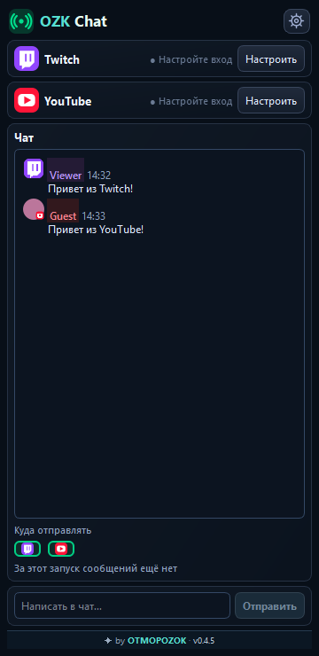
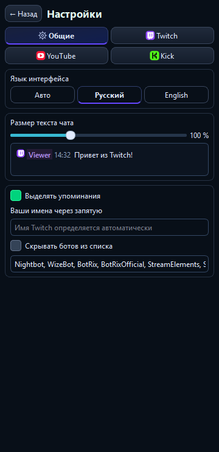
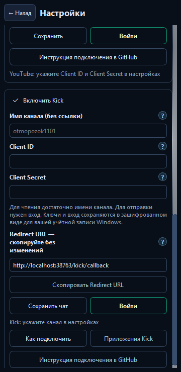
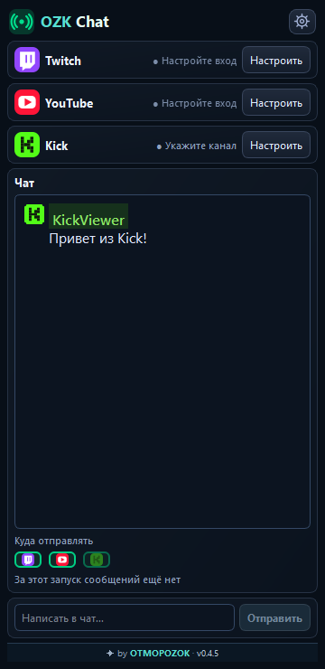

# OZK Multi Chat for OBS

Версия 0.4.8: шапка согласована с OZK Notify — одинаковые значок, отступы и кнопки сообщения и настроек. Самолётик открывает поле отправки чата.

Часть набора **OZK StreamKit** от OTMOPOZOK. Работает и отдельно от остальных плагинов.

**Первая стабильная версия до переименования: 0.4.2.** Она была проверена в OBS автором проекта.

**Сборка 0.4.8 для проверки:** настройки разделены на вкладки «Общие», Twitch, YouTube и Kick. Карточки, кнопки и поля оформлены в стиле OZK Notify. Снимки ниже сделаны в тестовом интерфейсе с примерными сообщениями.

**OZK Chat — мультичат для OBS Studio:** объединяет сообщения Twitch, YouTube и Kick в одной док-панели. Можно читать чат и отправлять ответы сразу на выбранные платформы.

**Twitch, YouTube и Kick с личными приложениями — версия 0.4.2.** Для каждого используемого сервиса создаётся своё приложение по [нашей инструкции](docs/REGISTER_APPS_RU.md).

## Как выглядит

Все снимки ниже сделаны с тестовыми сообщениями и пустыми полями входа. Личных данных и ключей на них нет.

| Чат Twitch и YouTube | Общие настройки |
| --- | --- |
|  |  |
| Подключение Kick | Сообщение Kick в общем чате |
|  |  |

[Узкая панель](docs/screenshots/chat-narrow-ru.png) · [English](docs/README_EN.md)

## Что удобно

- Читайте Twitch, YouTube и Kick, не выходя из OBS.
- В сообщениях YouTube видна аватарка автора; у Twitch и Kick на том же месте остаются их значки. Загрузка аватарок ограничена, а повторные сообщения используют уже загруженное изображение.
- Выбирайте язык и размер **сообщений чата** в настройках.
- Подключайте личные приложения Twitch, YouTube и Kick в настройках и входите через браузер. Данные входа остаются зашифрованными на вашем компьютере.
- У полей подключения есть значки «?» с коротким объяснением. Основные действия собраны в компактные пары кнопок.
- OZK Stats показывает измеренный CPU, учтённые данные и сетевой трафик Chat за время работы OBS.
- Упоминания ваших имён можно выделять цветом. Имя Twitch определяется после входа, остальные имена можно вписать в настройках.
- Ботов можно скрывать по редактируемому списку точных имён. Фильтр выключен по умолчанию и не удаляет сообщения из истории текущего запуска.
- Под чатом видно, сколько времени прошло с последнего принятого сообщения. Тишина сама по себе не означает обрыв связи.
- На карточках платформ различаются готовый чат с отправкой, режим только чтения и восстановление соединения.

## Как плагины работают вместе

Kick включается в настройках, получает свою карточку и зелёный значок K. Для чтения достаточно имени канала; для отправки нужен вход через личное приложение. [Пошаговая инструкция Kick](docs/KICK_RU.md).

OZK Chat работает самостоятельно: OZK Notify и OZK Stats для чата не нужны. Если установлен Stats, он считывает локальные показатели Chat для секции «Наши плагины». Notify может использовать сохранённый вход в Twitch и YouTube, а также имя канала Kick для проверки эфира; он не меняет данные входа Chat.

## Как установить

1. Полностью закройте OBS. Скачайте **OZKChat-0.4.8-OBS33-Windows-x64** на странице [последней успешной сборки](https://github.com/DIMI0007/ozk-chat/actions/workflows/build-windows.yml) и распакуйте ZIP.
2. Откройте `C:\ProgramData\obs-studio\plugins\`. Если там есть старая папка `stream-chat-obs`, удалите её. Скопируйте сюда папку `stream-chat-obs` из ZIP целиком.
3. Запустите OBS. Откройте **Док-панели → OZK Chat**. В шестерёнке введите данные личных приложений нужных сервисов по [инструкции подключения](docs/REGISTER_APPS_RU.md), сохраните и выполните вход.

Внутри папки `stream-chat-obs` должны лежать файлы `stream-chat-obs.dll` и `Qt6WebSockets.dll`, а также папка `data`. Настройки входа хранятся отдельно и при замене папки не удаляются. [Подробная инструкция](docs/INSTALL_RU.md).

Название папки и DLL оставлено прежним, чтобы сохранить настройки и расположение панели OBS. В самой OBS плагин называется **OZK Chat**.

[Как зарегистрировать приложения Twitch, YouTube и Kick: ссылки, кнопки и поля](docs/REGISTER_APPS_RU.md).

Для **OBS Studio 33 на Windows x64**. Сборка пока не подписана. Работа Kick проверена с настоящим аккаунтом; Twitch, YouTube и восстановление связи дополнительно проверяются во время реальных эфиров.

## Ещё

[Общий стиль трёх плагинов](docs/VISUAL_STYLE_RU.md) · [Лицензия GPL v2 или новее](LICENSE_NOTICE.md)

Разработчик: [OTMOPOZOK](https://www.youtube.com/channel/UCTAKYR3T2Ud8zZgNShgQfyw/).

## Поддержать проект

Если плагины полезны вам, поддержите проект донатом. Ваша помощь поддерживает развитие плагинов, исправления и будущую разработку.

[Поддержать через DonationAlerts](https://www.donationalerts.com/r/otmopozok) · [Поддержать через DonatePay](https://donatepay.ru/don/OTMOPOZOK)
